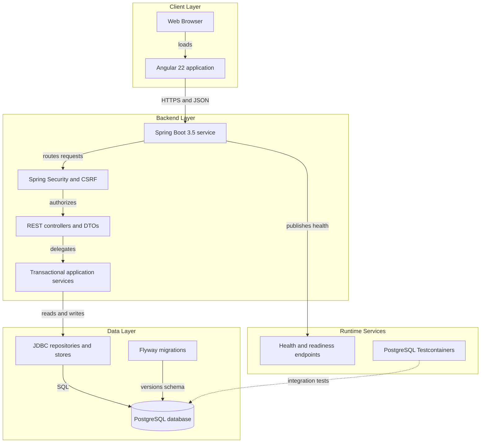
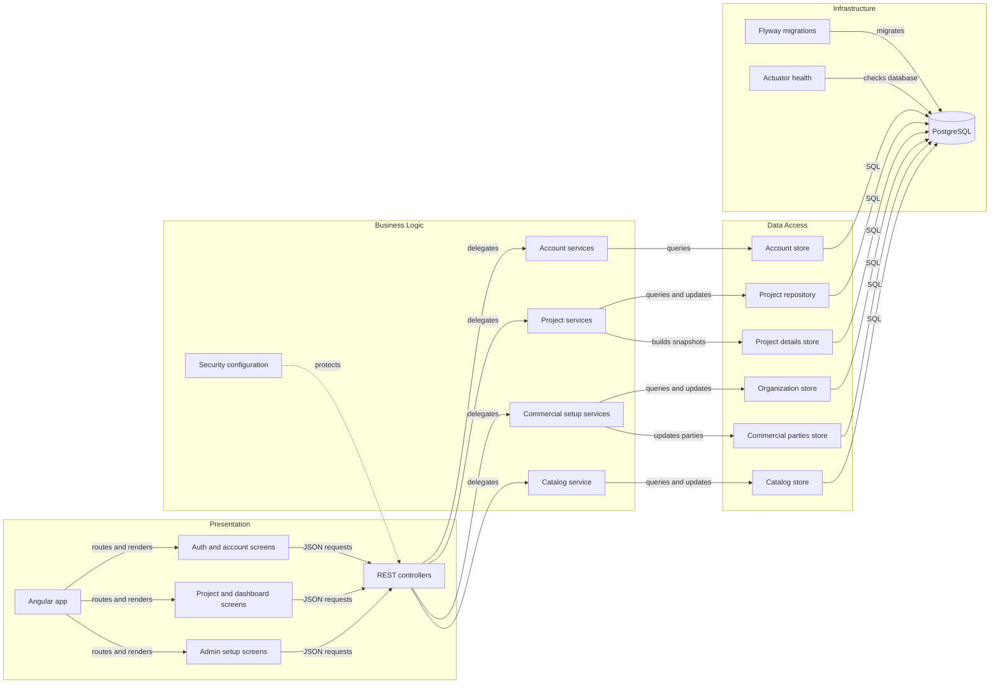

# Architecture Diagram

The Export Documentation Platform is a browser-based Angular application backed by a Spring Boot service and a PostgreSQL database. The current codebase is a modular monolith: identity, projects, commercial setup, catalog, traceability, documents, and audit share one deployable backend and one database.

## Application Architecture

<!-- mermaid-checked: no \n, no em-dash/en-dash, no {} in labels, subgraphs are id["label"], arrows are -->|"label"|, all subgraphs closed by end, ids unique -->

### Technology Stack Summary

| Layer | Technology | Version | Purpose |
|---|---|---|---|
| Client | Angular, Angular Material, RxJS | Angular 22, RxJS 7.8 | Browser UI, routing, forms, dashboard, project and account screens |
| Client contracts | TypeScript generated contract types | Current workspace contracts | Keeps frontend request and response shapes aligned with YAML API contracts |
| Backend runtime | Spring Boot, Spring MVC | 3.5.16 | HTTP service and dependency injection |
| Backend language | Java | 21 configured in integrated branch | Application implementation and transaction handling |
| Security | Spring Security, servlet sessions, CSRF cookie/header transport | Spring Boot managed | Authentication, authorization, session protection, and password flows |
| Persistence | PostgreSQL JDBC, Spring JDBC, selected Spring Data interfaces | PostgreSQL schema V1-V3 | Relational storage and constrained transactional reads/writes |
| Schema management | Flyway | Spring Boot managed | Versioned database migrations |
| Mapping and validation | MapStruct, Jakarta Validation, Jackson | Maven-managed | DTO mapping, request validation, and strict JSON parsing |
| Testing | JUnit, Spring Boot Test, Testcontainers | Maven-managed | Unit, MVC, and PostgreSQL integration tests |
| Observability | Spring Boot Actuator | Spring Boot managed | Health and readiness probes |

### Data Storage & External Services

The primary data store is PostgreSQL. It contains identity, access, projects, organizations, products, shipment traceability, document metadata, and audit history. No external message broker, object store, Redis cache, or third-party business API is wired into the current source. Authentication is designed around verified application identities and local account/session controls; an external identity provider can be configured through security settings, but it is not implemented as a separate application service in this repository.

### Key Architectural Decisions

- The backend is a modular monolith with package-level boundaries rather than independently deployed services.
- Flyway SQL migrations are authoritative; Hibernate runs in validation mode and does not create or alter the schema.
- Project writes combine application authorization, database constraints, row locking, version checks, and audit context to preserve consistency under concurrent updates.

## Component Relationships

<!-- mermaid-checked: no \n, no em-dash/en-dash, no {} in labels, subgraphs are id["label"], arrows are -->|"label"|, all subgraphs closed by end, ids unique -->

### Component Inventory

| Component | Layer | Type | Responsibility |
|---|---|---|---|
| Angular app | Presentation | Angular application shell | Bootstraps routing, shared providers, translations, and browser UI |
| Auth and account screens | Presentation | Angular feature components and services | Login, session state, password change, account and assignment views |
| Project and dashboard screens | Presentation | Angular feature components and services | Project lists, dashboard summaries, project details, and project edits |
| Admin setup screens | Presentation | Angular feature components and services | Organization, product, grade, and account administration |
| REST controllers | Presentation | Spring MVC controllers | Parse requests, apply DTO boundaries, and return problem details |
| Account services | Business logic | Spring services | Resolve identity, accounts, roles, sessions, and assignments |
| Project services | Business logic | Spring services | Create, read, list, patch, authorize, and version project data |
| Commercial setup services | Business logic | Spring services | Manage organizations and assign commercial project parties |
| Catalog service | Business logic | Spring service | Manage products, categories, grades, defaults, and versioned changes |
| Security configuration | Business logic and cross-cutting | Spring Security configuration and filters | Authentication, authorization, sessions, password rules, and CSRF |
| Account store | Data access | JDBC persistence adapter | Reads and writes account and assignment records |
| Project repository | Data access | Repository adapter | Project aggregate persistence and version-aware updates |
| Project details store | Data access | JDBC read adapter | Coherent project snapshot and related data reads |
| Organization store | Data access | JDBC persistence adapter | Organization directory and role persistence |
| Catalog store | Data access | JDBC persistence adapter | Product and grade catalog persistence |
| Commercial parties store | Data access | JDBC persistence adapter | Project party selection and updates |
| Flyway migrations | Infrastructure | SQL migration layer | Creates and evolves the PostgreSQL schema |
| PostgreSQL | Infrastructure | Relational database | Durable system of record |
| Actuator health | Infrastructure | Health endpoint | Reports application and database readiness |
