# Data Architecture & Persistence Layer

The application uses one PostgreSQL database for identity, authorization, shipment projects, commercial master data, traceability, and document metadata. Spring Boot uses JDBC-backed repositories and services, with Flyway migrations as the schema authority and Hibernate validation rather than schema generation.

## Database Configuration

| Service/Module | DB Type | Profile | Driver | Connection | Migration Tool |
|---|---|---|---|---|---|
| ExportDocs backend | PostgreSQL | Default and local development | PostgreSQL JDBC | Environment-configured JDBC URL; default database is `exportdocs` on localhost | Flyway V1, V2, V3 |
| ExportDocs backend tests | PostgreSQL | Integration tests | PostgreSQL JDBC via Testcontainers | Isolated PostgreSQL container | Flyway migrations run against the test database |

Schema behavior is validate-only at runtime: Hibernate validates mappings, while Flyway applies versioned SQL migrations. The database uses UTC timestamps, UUID identifiers, transactional writes, and PostgreSQL constraints for uniqueness, referential integrity, and exact decimal quantities. No Redis, cache provider, or second-level Hibernate cache was found.

## Data Ownership per Service

| Service | Tables Owned | ORM Framework | Caching | Notes |
|---|---|---|---|---|
| Account and access | `app_user`, `role_assignment`, `local_account`, `project_access`, `project_form_assignment` | Spring JDBC repositories and transactional services | None detected | Local account/session security is backed by the shared identity model |
| Project and shipment | `project`, `project_party`, `shipment_transport`, `container`, `project_factory`, `project_product` | Spring JDBC repositories and transactional services | None detected | Project is the aggregate root for shipment setup |
| Party and catalog | `organization`, `organization_role`, `organization_address`, `city`, `factory`, `factory_approval`, `product`, `product_category` | Spring JDBC repositories and transactional services | None detected | Admin-managed master data is selected by project setup |
| Traceability and processing | `fishing_vessel`, `catch_certificate`, `catch_lot`, `processing_batch`, `raw_material_allocation`, `finished_product_quantity`, `processing_output_adjustment` | SQL migrations and backend persistence boundary | None detected | Schema is present for later traceability and quantity workflows |
| Documents and audit | `document_type`, `document_template_version`, `document_instance`, `document_version`, `audit_log` | SQL migrations and backend persistence boundary | None detected | Supports versioned generated documents and audit history |

## Entity Model

```mermaid
erDiagram
    APP_USER ||--o{ ROLE_ASSIGNMENT : "has roles"
    APP_USER ||--o{ PROJECT_ACCESS : "can access"
    PROJECT ||--o{ PROJECT_ACCESS : "grants access"
    APP_USER ||--o{ PROJECT : "creates"
    PROJECT ||--o{ PROJECT_PARTY : "has parties"
    ORGANIZATION ||--o{ PROJECT_PARTY : "participates"
    ORGANIZATION ||--o{ ORGANIZATION_ROLE : "declares roles"
    ORGANIZATION ||--o{ ORGANIZATION_ADDRESS : "has addresses"
    PROJECT ||--o| SHIPMENT_TRANSPORT : "has transport"
    PROJECT ||--o{ CONTAINER : "uses containers"
    PROJECT ||--o{ CATCH_LOT : "contains catch lots"
    FISHING_VESSEL ||--o{ CATCH_LOT : "harvests"
    PRODUCT ||--o{ CATCH_LOT : "identifies catch"
    PROJECT ||--o{ PROCESSING_BATCH : "contains batches"
    PROCESSING_BATCH ||--o{ RAW_MATERIAL_ALLOCATION : "consumes"
    CATCH_LOT ||--o{ RAW_MATERIAL_ALLOCATION : "is allocated"
    PROCESSING_BATCH ||--o{ FINISHED_PRODUCT_QUANTITY : "produces"
    PRODUCT ||--o{ FINISHED_PRODUCT_QUANTITY : "is produced"
    PROJECT ||--o{ DOCUMENT_INSTANCE : "has documents"
    DOCUMENT_TYPE ||--o{ DOCUMENT_INSTANCE : "classifies"
    DOCUMENT_INSTANCE ||--o{ DOCUMENT_VERSION : "has versions"
    APP_USER ||--o{ AUDIT_LOG : "performs actions"
    PROJECT ||--o{ AUDIT_LOG : "is audited"
    PRODUCT ||--o{ PRODUCT_CATEGORY : "has categories"
    PROJECT ||--o{ PROJECT_PRODUCT : "selects products"
    PRODUCT ||--o{ PROJECT_PRODUCT : "is selected"
    APP_USER {
        uuid id PK
        string externalSubject UK
        string displayName
        boolean active
    }
    ROLE_ASSIGNMENT {
        uuid userId PK "also FK to APP_USER"
        string role PK
    }
    PROJECT {
        uuid id PK
        string reference UK
        string status
        int version
        uuid createdBy FK
    }
    PROJECT_ACCESS {
        uuid projectId PK "also FK to PROJECT"
        uuid userId PK "also FK to APP_USER"
        string accessRole
    }
    PROJECT_PARTY {
        uuid projectId PK "also FK to PROJECT"
        uuid organizationId PK "also FK to ORGANIZATION"
        string role PK
    }
    ORGANIZATION {
        uuid id PK
        string legalName
        string countryCode
        boolean active
    }
    ORGANIZATION_ROLE {
        uuid organizationId PK "also FK to ORGANIZATION"
        string role PK
    }
    ORGANIZATION_ADDRESS {
        uuid id PK
        uuid organizationId FK
        string countryCode
        string city
    }
    SHIPMENT_TRANSPORT {
        uuid projectId PK "also FK to PROJECT"
        uuid portOfLoadingId FK
        uuid portOfDischargeId FK
        string carrier
    }
    CONTAINER {
        uuid id PK
        uuid projectId FK
        string containerNumber
    }
    FISHING_VESSEL {
        uuid id PK
        string name
        string flagCountry
    }
    CATCH_LOT {
        uuid id PK
        uuid projectId FK
        uuid vesselId FK
        uuid productId FK
        decimal quantityKg
    }
    PROCESSING_BATCH {
        uuid id PK
        uuid projectId FK
        uuid processorId FK
        string batchReference
    }
    RAW_MATERIAL_ALLOCATION {
        uuid id PK
        uuid projectId FK
        uuid catchLotId FK
        uuid processingBatchId FK
        decimal quantityKg
    }
    FINISHED_PRODUCT_QUANTITY {
        uuid id PK
        uuid projectId FK
        uuid productId FK
        uuid processingBatchId FK
        decimal quantityKg
    }
    PRODUCT {
        uuid id PK
        string code UK
        string name
        string scientificName
    }
    PRODUCT_CATEGORY {
        uuid id PK
        uuid productId FK
        string name
    }
    PROJECT_PRODUCT {
        uuid projectId PK "also FK to PROJECT"
        uuid productId PK "also FK to PRODUCT"
        uuid categoryId FK
    }
    DOCUMENT_TYPE {
        string code PK
        string name
    }
    DOCUMENT_INSTANCE {
        uuid id PK
        uuid projectId FK
        string documentTypeCode FK
        string status
    }
    DOCUMENT_VERSION {
        uuid id PK
        uuid documentInstanceId FK
        int version
        uuid generatedBy FK
    }
    AUDIT_LOG {
        uuid id PK
        uuid projectId FK
        uuid actorId FK
        string action
    }
```

<!-- mermaid-checked: every attribute is `<type> <name> [<key>] ["<description>"]` with at most one of PK/FK/UK, no \n in descriptions, no {} in descriptions, every relationship label is double-quoted -->

The diagram shows the core relationships. Ports, factories, certificates, document templates, local accounts, and form assignments are additional schema entities connected through the same project, organization, and account keys.

## Key Repository Methods

| Service | Repository | Notable Methods | Purpose |
|---|---|---|---|
| Account and access | `AccountStore` | Account lookup by external subject; active account and role reads; account updates | Resolves authenticated application identity and account state |
| Account and access | `AssignmentService` and assignment persistence | Project access and form assignment reads/writes | Enforces project-scoped permissions |
| Project | `ProjectRepository` | Project lookup, visibility-filtered page queries, version-aware updates | Reads and updates the project aggregate with optimistic version checks |
| Project | `ProjectDetailsStore` | Snapshot reads and party/transport aggregation | Builds coherent project representations under repeatable-read transactions |
| Commercial parties | `OrganizationStore` | Organization list/detail/update and role checks | Manages admin directory data |
| Commercial parties | `OrganizationSelectionStore` | Sorted locked organization selection | Prevents deactivation or role removal races during project setup |
| Catalog | `CatalogStore` | Product and grade/default reads and versioned writes | Manages protected product master data |
| Commercial project setup | `CommercialPartiesStore` | Project party reads and replacement writes | Applies supplier, client, importer, and consignee selections |

## Caching Strategy

No application cache, Redis provider, cache annotations, or Hibernate second-level cache was detected. Reads are served from PostgreSQL, with transaction isolation and explicit row locks used for consistency rather than caching. Session state is handled by Spring Security and the servlet session cookie, not by a separate distributed cache.

## Data Ownership Boundaries

The current deployment has one shared PostgreSQL database and one Spring Boot backend. Logical ownership is separated by package and table family, but the services are not independently deployable and do not communicate through inter-service APIs or message brokers. Cross-domain access occurs through backend stores and transactional services, especially when project setup selects organizations, products, ports, factories, or accounts. Project reads use snapshot-style transactions; writes use row locks, version checks, and database constraints.

### Data Classification & Sensitivity

| Entity | Sensitive Fields | Classification | Controls in Place |
|---|---|---|---|
| `app_user` and `local_account` | External identity subject, display name, email or account metadata where configured | PII | Role checks, active-state checks, password/session security; no field-level encryption detected |
| `organization` and `organization_address` | Legal names, addresses, registration and country information | PII / business confidential | Admin-only mutation and project visibility rules; no field-level masking detected |
| `project_party` and project records | Supplier, client, importer, consignee associations and shipment references | PII / business confidential | Project access and form assignments; no field-level encryption detected |
| `audit_log` | Actor identity, request metadata, project and action history | PII / operational audit | Transaction-local actor context and append-oriented audit behavior |
| `catch_lot`, `processing_batch`, and document data | Shipment traceability and regulatory information | Business/regulatory confidential | Database authorization and project-scoped access; no PHI or PCI data detected |
