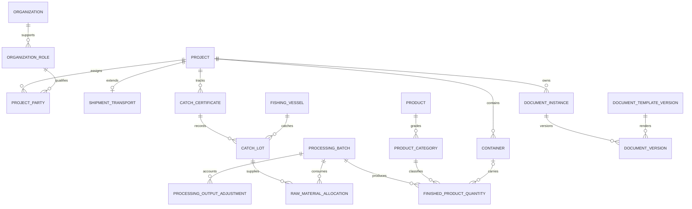

# Phase 1 architecture foundations

This branch combines the database/bootstrap, Project REST, internal accounts/form assignments and commercial setup slice 1. One project **is** one shipment. Commercial setup adds company roles, supplier/client/importer/consignee selections and ADMIN-controlled product/grade defaults. The V1/V2 baseline passed 94 tests on host PostgreSQL. The new slice compiles/packages and passes 50 unit plus 18 contract checks. Host V3/schema and all existing PostgreSQL cases pass; commercial API acceptance awaits a corrected CSRF test fixture and full rerun. See VALIDATION.md and `../../backend/COMMERCIAL-SETUP-IMPLEMENTATION-HANDOFF.md`. Angular, shipment invoice/packing entry, OCR/imports, PDF generation and workflow transitions remain separate work.

## Layout and decisions

```text
backend/                  Java 21, Spring Boot 3.5.16, Maven
  src/main/java/com/exportdocs/
    ExportDocsApplication.java
    project/              project setup, access and commercial parties
    party/                organization directory and company selection
    catalog/              product/grade definitions and protected defaults
    account/              internal accounts, sessions and form assignments
  src/main/resources/
    application.yml
    db/migration/         Flyway is the sole schema owner
  src/test/               PostgreSQL/Testcontainers integration checks
frontend/                 Angular, exclusively owned by its agent
docs/contracts/           versioned OpenAPI and integration semantics
docs/architecture/        decisions, relationships, evidence
infra/                    local run helpers; root Compose is canonical
```

Use one modular monolith, one relational database and synchronous transactions. Within growing modules, use `api -> application -> domain` and infrastructure adapters; controllers call services, not repositories. Do not add generic service frameworks or separate deployable services. The master plan's module-first layout takes precedence over the older top-level layer list in AGENTS.md; shared bootstrap lives under infrastructure. DTO mappings use MapStruct, as AGENTS.md requests.

The project row is the shipment identity. `shipment_transport` is an optional data extension whose PK is the project UUID; it cannot represent a second shipment. Agent 2 creates that row even if all transport fields are initially null. Directory organizations have multiple roles; project links select those roles. Legacy producer arrays remain supported. The new commercial setup permits one supplier, client, importer and consignee per completed shipment; drafts may omit them. Trinity is only a tag. The supplier invoice is billed to the consignee; invoice persistence follows in slice 2.

UUID identifiers are opaque. Weights use numeric(18,3) kg; no floating-point mass or financial values. Catch original quantity/unit can be preserved together, but normalization must be verified by the service; no implicit conversion factor is invented. Events use timestamptz, shipment/production dates use date. V3 adds nullable ADMIN-controlled carton net-weight and price/currency defaults to grades. Shipment invoice/packing records and immutable applied-default snapshots follow in slice 2.

Spring Boot 3 stays within the repository's agreed major version; 3.5.16 is pinned using the [official 3.5 documentation](https://docs.spring.io/spring-boot/3.5/system-requirements.html). Java target is 21. Flyway includes its [PostgreSQL module](https://documentation.red-gate.com/flyway/reference/database-driver-reference/postgresql-database). Maven's Boot parent manages dependency versions, including Testcontainers. The historical V1/V2 host Maven verify run passed: compilation for Java 21, generated mappings, packaging, 17 unit tests and 77 real PostgreSQL integration tests were verified. New commercial acceptance is tracked separately above. See VALIDATION.md and `../../backend/VERIFICATION-RECHECK-2026-11-12.md`. Review support/security patch policy before production deployment.

## The 26 tables and why they exist

| Module | Tables | Purpose and important links |
|---|---|---|
| Identity | app_user, role_assignment, local_account | Internal users/roles and separate hashed credentials; external_subject is optional legacy mapping. No default accounts or plaintext passwords. |
| Project access | project_access, project_form_assignment | Membership grants shipment-wide read access; named form grants add operator editing. Services enforce both. |
| Directory | organization, organization_role | Company/partner identity plus any number of business roles. No exclusive company type. |
| Locations | port | Shared port name, country, optional unique UN/LOCODE; referenced by transport. |
| Products | product, product_category | Product/species/HS information and configurable box-size grades per product. Category is not a species. |
| Shipment | project, project_party, shipment_transport, container | Setup/status/revision; role-qualified party links; one transport extension; many containers. Seal and late lock are independent nullable fields. |
| Raw traceability | fishing_vessel, catch_certificate, catch_lot | Shared vessel directory, project certificate, vessel-linked raw catches by lot/product/date. One certificate has many lots/vessels. |
| Processing | processing_batch, raw_material_allocation | Many-to-many allocation of raw catch lots into processing batches, with exact allocated kg. |
| Finished output | finished_product_quantity, processing_output_adjustment | Batch/product/grade cartons, finished net and optional gross/container; explicitly described losses/by-products/other outputs. |
| Documents | document_type, document_template_version, document_instance, document_version | Five output families; immutable template versions; logical documents; immutable rendered variants with snapshots/hashes/source revisions. |
| History | audit_log | Transactional before/after JSON, operation, actor, request, project, timestamp. Append-only under normal row DML. |



All shipment-scoped child links use composite (entity_id, project_id) foreign keys when referencing another project-owned entity. A lot in project A cannot feed a batch in project B; a finished quantity cannot reference another shipment's container. Product/category pairing is also enforced with a composite foreign key. Master data is deliberately shared.

## Enforced boundaries and deferred rules

Database checks enforce normalized unique project references including archived projects, status vocabulary, role-qualified parties, nonnegative revision, positive quantities/cartons, gross >= finished net where gross is supplied, basic date ordering within catch/production records, unique container numbers per shipment, and foreign-key integrity. Unknown container numbers may remain null. Container syntax uses the ISO shape; ISO 6346 **check digit** validation remains Agent 2/future transport validation work, not an implemented database guarantee. Country/HS/UN/LOCODE checks validate shape; active official code lists remain application validation.

A trigger locks the source catch lot and rejects allocations exceeding its raw kg. Reducing raw kg below the allocated sum also fails. Allocation writers must use PostgreSQL's default READ COMMITTED isolation, or a correctly retried SERIALIZABLE transaction; this locking implementation is not a promise of correctness at REPEATABLE READ. Services should lock multiple lots in stable UUID order and retry deadlocks when appropriate. Live concurrent behavior is not yet exercised here.

Views calculate totals without storing duplicate totals:

- `catch_certificate_totals`: sum raw catch lots per certificate, once per lot.
- `processing_batch_balance`: allocated input raw kg, finished net kg, accounted other outputs, unaccounted difference and yield percent. Each relation is independently aggregated to avoid multiplying sums across joins.
- `document_version_freshness`: compares snapshot source_revision to current project.version. Stale is derived; historical document rows never mutate. It conservatively invalidates all versions on a project change until field-level impact analysis exists.

The fictional test uses 22,000 input -> 19,200 finished + 2,800 other accounted output (87.2727% yield). It is a mathematical fixture, **not a default recipe, tolerance, loss classification or equality rule**. Incomplete batches may be unbalanced while entering data. The owner subsequently confirmed that no loss/by-product or yield-reconciliation gate is required for this workflow; see QUANTITY-MODEL.md. Keep entered measurements coherent without making the illustrative balance a mandatory task. Full invoice and packing allocations come in their own subsequent migrations.

## Document consistency

| Canonical source | Shared information | Consumers |
|---|---|---|
| project and project_party | Reference, exporter/producer/consignee/notify/forwarder/carrier, destination, ETD | All relevant output families |
| product and product_category | Product/species/HS and box-size grade | HC, CC, CO, draft BL descriptions and later commercial forms |
| catch_certificate and catch_lot | Vessel IDs, certificate references, raw catch kg, catch/landing dates | CC, HC supporting traceability, separate Shipping List |
| allocations and processing batches | Catch-to-batch provenance, production/date/yield | HC, CC reconciliation, Shipping List |
| finished_product_quantity | Cartons, finished net/gross, grade, container allocation | HC, draft BL, CO, future packing forms |
| container | Container ID and seal; separate late lock | Consuming documents that explicitly request each field |
| shipment_transport | Shipping vessel (distinct from fishing vessel), voyage, ports, carrier BL reference | Draft BL, HC/CO as needed |
| document_version | Pinned template, source revision, immutable JSON facts/hash | Historical previews/downloads and review records |

`document_type` seeds only HC, BL_DRAFT, CC, CO and SHIPPING_LIST. Shipping List has its own logical document and version; parent_document_id can attach it to an HC instance in the same project. The renderer/service must validate that the relationship is Shipping List -> HC; this semantic type rule is not claimed as a database constraint. V1 permits multiple CC/HC logical keys, but the owner has now confirmed one logical CC and one HC per shipment; narrow this through the next coordinated migration, preserving revision/variant history. See QUANTITY-MODEL.md. Packing List is not a Shipping List alias and is not seeded as a confirmed generated output.

Two variants are supported: UNSIGNED_FOR_SIGNATURE and CLIENT_PREVIEW. Metadata cannot prove the absence of graphics or presence of page watermarks; future rendering tests must verify every page. No generated record represents official external issuance. Authorized external originals/approval records need a later, separate model. Template/version rows reject UPDATE/DELETE; ordinary application roles must not receive TRUNCATE/DDL privileges. Storage keys are private internal references, never public URLs. Artifact bytes/storage and retention are not implemented in Phase 1.

V1 audit triggers cover its 23 non-audit tables. V2 adds form-assignment auditing and a dedicated credential audit that removes password_hash; all records share the business transaction. The static document-type bootstrap is installed before those triggers. Set transaction-local app.actor_id and app.request_id on the transaction's JDBC connection, as specified in the contract. API writes must set a trusted actor; maintenance without an actor is explicitly SYSTEM. Project.version/updated_at increments remain the application service's responsibility, including child changes; audit triggers do not increment them repeatedly per row. No hard-delete project endpoint: soft archive preserves references/history.

## Project creation and handoff

See `../contracts/README.md` for the exact atomic create/PATCH algorithm, ID mapping, audit context and error semantics. Minimal request is `{"reference":"DEMO-001"}`. Agent 2 saves one project (DRAFT_DATA, version 0), transport extension, creator access and audit records in a single transaction, returning the documented response and Location. Parties/ports/dates are optional and may arrive later. Validation for document readiness is separate from draft persistence.

Project get/list use REPEATABLE READ to keep root version, child rows and pagination counts in one snapshot. Write/allocation transactions retain their intended default isolation.

The frontend generates its client from `../contracts/projects-v1.yaml` and implements only those types/operations. Nullable response fields are always present. Presence-aware PATCH commands must retain explicit null vs omitted. Neither this architect nor the frontend should duplicate Agent 2's business controllers. Directory selectors need Agent 2 lookup APIs or fictional development fixtures; directory endpoints are not yet contracted.

Local run instructions: `../../infra/README.md`. Verification evidence: `VALIDATION.md`. Open requirements and contradictions: `DECISIONS.md`. Existing master plan/playbooks remain unmodified; no checkboxes are marked complete on the basis of static checks.
